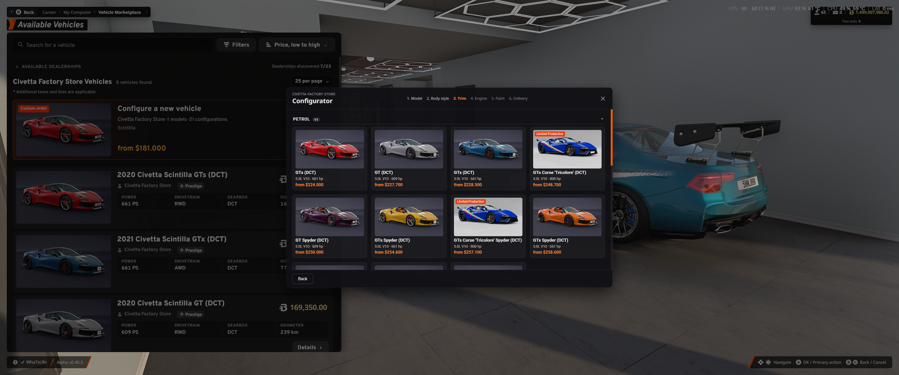

# RLS Configurator

Order a brand-new car exactly the way you want it from the factory stores in **RLS Career Overhaul** for BeamNG.drive.

*Deutsche Version weiter unten.*



## Features

- **"Configure a new vehicle" card** at the top of every brand factory store's vehicle list. Stores are detected automatically on every map, and no new shops are added.
- **Step-by-step flow:** model → body style → trim → engine → paint → delivery
  - Covers current models only (newest generation), including configs from installed vehicle mods.
  - Cherrier FCV is split into Vivace, Tograc and Ardente.
  - Trims are grouped by Petrol / Diesel / Electric / Other / Motorsport / Custom and can be sorted by price or power.
  - Limited runs (e.g. Scintilla Tricolore, ETK Rennspecht) are listed with the regular trims.
  - Motorsport configs (Race, Rally, Drift, Drag) can be ordered for an extra surcharge.
- **Engine swap**
  - Put any compatible engine into your chosen trim, including across models where parts fit (e.g. ETK 800 / K-Series / 900) and petrol ↔ electric.
  - The matching gearbox, shifter, pedals, drive modes and gauges come with the engine. Where possible the car keeps its own exhaust.
  - The price is based on the actual part values. You can filter donors by car and engines by category.
- **Delivery options**
  - Standard, Express and Priority delivery, each with its own delivery time and surcharge.
  - **Garage delivery** (small fee) or **pickup at the dealer's freight point**. For pickup, the car appears there once it is ready.
- **The rest is normal RLS:** the order goes through the regular RLS purchase menu, so taxes, insurance, trade-in and inventory work as usual. Resale value is based on the car's value. Surcharges are not refunded when you sell.
- **English and German**, picked automatically from the game language.
- **Fully separable**
  - No RLS or vanilla files are overridden.
  - Disable the mod in the mod manager and the configurator is gone. Cars you already bought stay normal cars.

## Requirements

- BeamNG.drive 0.40.x
- RLS Career Overhaul 2.8.x (tested with 2.8.0.2 beta)

## Installation

1. Download `rls_configurator.zip` from the [Releases](../../releases) page (or from the BeamNG repository).
2. Put the zip **as is** into `%LocalAppData%\BeamNG\BeamNG.drive\current\mods\`. Don't unpack it.
3. Start the game, load your RLS career, open *My Computer → Vehicle Marketplace* and pick a brand factory store.

## Settings

All options are in `gameplay/rlsConfigurator/settings.json` inside the zip. Each block has a short comment. The most useful options:

| Key | Default | Meaning |
|---|---|---|
| `configuratorSurchargePct` | 8 | Surcharge for a custom order |
| `motorsportSurchargePct` | 15 | Extra surcharge for Race/Rally/Drift/Drag configs |
| `deliveryTiers` | 30 / 10 / 2 min | Delivery time and surcharge per tier |
| `defaultFulfilment` | `garage` | Pre-selected hand-over: `garage` or `pickup` |
| `engineSwapModels` | `["*"]` | Models that allow engine swaps |
| `allowEnergyTypeSwap` | true | Allow petrol ↔ electric swaps |
| `factoryLikeConfigTypes` / `factoryLikeConfigPatterns` | Factory, Limited Production / rennspecht | Configs listed with the regular trims |
| `excludedConfigTypes` / `excludedConfigPatterns` | Police, Service, … | Configs that are never offered |
| `debugDump` | false | Write diagnostic files to the BeamNG user folder |

To change settings: unpack the zip into `mods/unpacked/rls_configurator/`, edit the file and remove the zip. Or edit the file inside the zip.

## Known limitations

- Engine swaps between very different cars are blocked automatically when the parts don't fit.
- Mod vehicles can only be configured if they are sold in a factory store, which means their brand must have a store on the map.
- For pickup orders, RLS still shows its own "ready at freight pickup" message.

## Building from source

```
python build.py
```

This creates `dist/rls_configurator.zip`, with `lua/`, `ui/` and `gameplay/` at the root of the zip.

## Credits

- Idea, design and testing: Max (Wha7sLife)
- Built for RLS Career Overhaul by the RLS team. This is an unofficial add-on and not affiliated with the RLS team or BeamNG GmbH.

## License

MIT, see [LICENSE](LICENSE).

---

## Deutsch

Mit diesem Mod bestellst du in den Werksshops von **RLS Career Overhaul** einen Neuwagen nach deinen Wünschen.

**Funktionen**
- Karte „Neues Fahrzeug konfigurieren“ in der Fahrzeugliste jedes Marken-Werksshops. Die Shops werden pro Karte automatisch erkannt.
- Ablauf: Modell → Karosserie → Ausstattung → Motor → Lack → Lieferung.
- Motortausch mit passenden Motoren, auch modellübergreifend und zwischen Benzin und Elektro. Getriebe, Schalthebel, Pedale, Fahrmodi und Instrumente kommen vom Spender, der Preis richtet sich nach dem Teilewert.
- Lieferung in die Garage (kleine Gebühr) oder Abholung am Frachtpunkt des Händlers, Lieferzeit je nach Stufe.
- Englisch und Deutsch, je nach Spielsprache.
- Komplett trennbar: Es werden keine RLS- oder Vanilla-Dateien überschrieben. Mod deaktivieren, und der Konfigurator ist weg.

**Installation:** `rls_configurator.zip` ungeöffnet nach `%LocalAppData%\BeamNG\BeamNG.drive\current\mods\` legen. Voraussetzung sind BeamNG.drive 0.40.x und RLS Career Overhaul 2.8.x.

**Einstellungen:** `gameplay/rlsConfigurator/settings.json`, siehe Tabelle oben.
