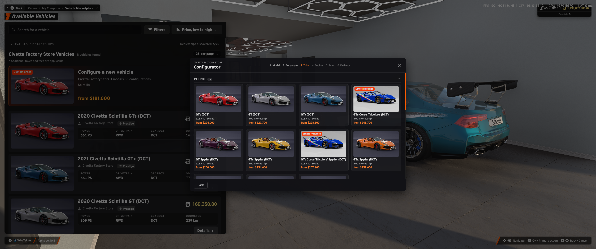

# RLS Configurator

Order a brand-new car exactly the way you want it from the brand stores in **RLS Career Overhaul** for BeamNG.drive.

*Deutsche Version weiter unten.*



## Features

- **"Configure a new vehicle" card** at the top of every brand store's vehicle list. Stores are detected automatically on every map, and no new shops are added. This covers the factory stores on West Coast as well as single-brand stores like the "Online Dealerships" on RLS Italy.
- **Step-by-step flow:** model → body style → trim → engine → packages → paint → delivery
  - Covers current models only (newest generation), including configs from installed vehicle mods.
  - Cherrier FCV is split into Vivace, Tograc and Ardente.
  - Trims are grouped by Petrol / Diesel / Electric / Other / Motorsport / Custom and can be sorted by price or power.
  - Limited runs (e.g. Scintilla Tricolore, ETK Rennspecht) are listed with the regular trims.
  - Motorsport configs (Race, Rally, Drift, Drag) can be ordered for an extra surcharge.
- **Engine swap**
  - Put any compatible engine into your chosen trim, including across models where parts fit (e.g. ETK 800 / K-Series / 900) and petrol ↔ electric.
  - The matching gearbox, shifter, pedals, drive modes and gauges come with the engine. Where possible the car keeps its own exhaust.
  - The price is based on the actual part values. You can filter donors by car and engines by category.
- **Equipment packages:** take the wheels & tyres or the suspension of another trim of the same model line. You pay the part value difference.
- **Info sheet and comparison:** an "i" button shows the in-game description and a data sheet; "⇄" puts up to three trims side by side.
- **Order overview:** progress and remaining time of your orders. Cars waiting for pickup can get a route or be sent to a garage instead.
- **Dealer reputation bonus:** a better reputation with the dealer lowers the configurator surcharge.
- **Delivery options**
  - Standard, Express and Priority delivery, each with its own delivery time and surcharge.
  - **Garage delivery** (small fee) or **pickup at the dealer's freight point**. For pickup, the car appears there once it is ready.
- **The rest is normal RLS:** the order goes through the regular RLS purchase menu, so taxes, insurance, trade-in and inventory work as usual. Resale value is based on the car's value. Surcharges are not refunded when you sell.
- **English and German**, picked automatically from the game language.
- **Fully separable**
  - No RLS or vanilla files are overridden.
  - Disable the mod in the mod manager and the configurator is gone. Cars you already bought stay normal cars.

## Requirements

- BeamNG.drive 0.40.x
- RLS Career Overhaul 2.8.x (tested with 2.8.0.2 beta)

## Installation

1. Download `rls_configurator.zip` from the [Releases](../../releases) page (or from the BeamNG repository).
2. Put the zip **as is** into `%LocalAppData%\BeamNG\BeamNG.drive\current\mods\`. Don't unpack it.
3. Start the game, load your RLS career, open *My Computer → Vehicle Marketplace* and pick a brand factory store.

## Settings

All options are in `gameplay/rlsConfigurator/settings.json` inside the zip. Each block has a short comment. The most useful options:

| Key | Default | Meaning |
|---|---|---|
| `configuratorSurchargePct` | 8 | Surcharge for a custom order |
| `reputationSurchargeReduction` | 2 / 4 / 6 | Points off the surcharge from reputation level 2 / 3 / 4 |
| `packagesEnabled` / `packageRefundPct` | true / 50 | Equipment packages and refund share for downgrades |
| `packageCategories` | wheels, suspension | Package categories and the slot names they cover |
| `detectLocalBrandStores` | true | Also use single-brand stores that sell through a normal dealer lot |
| `localStoresAsOnline` | true | Checkout of such stores works like an online order (needed on RLS Italy) |
| `motorsportSurchargePct` | 15 | Extra surcharge for Race/Rally/Drift/Drag configs |
| `deliveryTiers` | 30 / 10 / 2 min | Delivery time and surcharge per tier |
| `defaultFulfilment` | `garage` | Pre-selected hand-over: `garage` or `pickup` |
| `engineSwapModels` | `["*"]` | Models that allow engine swaps |
| `allowEnergyTypeSwap` | true | Allow petrol ↔ electric swaps |
| `factoryLikeConfigTypes` / `factoryLikeConfigPatterns` | Factory, Limited Production / rennspecht | Configs listed with the regular trims |
| `excludedConfigTypes` / `excludedConfigPatterns` | Police, Service, … | Configs that are never offered |
| `debugDump` | false | Write diagnostic files to the BeamNG user folder |

To change settings: unpack the zip into `mods/unpacked/rls_configurator/`, edit the file and remove the zip. Or edit the file inside the zip.

## Known limitations

- Engine swaps between very different cars are blocked automatically when the parts don't fit.
- Mod vehicles can only be configured if their brand has a store on the map.
- Packages are only offered between trims that use the same wheel/suspension slots, so parts always fit. Some mod cars name their slots differently; `packageCategories` can be adjusted.
- On RLS Italy, the regular (non-configurator) listings of the online dealerships are still subject to RLS's own checkout rules.
- For pickup orders, RLS still shows its own "ready at freight pickup" message.

## Building from source

```
python build.py
```

This creates `dist/rls_configurator.zip`, with `lua/`, `ui/` and `gameplay/` at the root of the zip.

## Credits

- Idea, design and testing: Max (Wha7sLife)
- Built for RLS Career Overhaul by the RLS team. This is an unofficial add-on and not affiliated with the RLS team or BeamNG GmbH.

## License

MIT, see [LICENSE](LICENSE).

---

## Deutsch

Mit diesem Mod bestellst du in den Werksshops von **RLS Career Overhaul** einen Neuwagen nach deinen Wünschen.

**Funktionen**
- Karte „Neues Fahrzeug konfigurieren“ in der Fahrzeugliste jedes Markenshops. Die Shops werden pro Karte automatisch erkannt, auch die Online-Händler auf RLS Italy.
- Ablauf: Modell → Karosserie → Ausstattung → Motor → Pakete → Lack → Lieferung.
- Pakete: Felgen und Reifen oder Fahrwerk aus einer anderen Ausführung desselben Modells, bezahlt wird der Wertunterschied der Teile.
- Info-Fenster mit Ingame-Beschreibung und Datenblatt, Vergleich von bis zu drei Ausführungen.
- Bestellübersicht mit Fortschritt und Restzeit. Abholbereite Autos lassen sich per Route finden oder in die Garage liefern.
- Händlerbonus: Guter Ruf beim Händler senkt den Konfigurator-Aufschlag.
- Motortausch mit passenden Motoren, auch modellübergreifend und zwischen Benzin und Elektro. Getriebe, Schalthebel, Pedale, Fahrmodi und Instrumente kommen vom Spender, der Preis richtet sich nach dem Teilewert.
- Lieferung in die Garage (kleine Gebühr) oder Abholung am Frachtpunkt des Händlers, Lieferzeit je nach Stufe.
- Englisch und Deutsch, je nach Spielsprache.
- Komplett trennbar: Es werden keine RLS- oder Vanilla-Dateien überschrieben. Mod deaktivieren, und der Konfigurator ist weg.

**Installation:** `rls_configurator.zip` ungeöffnet nach `%LocalAppData%\BeamNG\BeamNG.drive\current\mods\` legen. Voraussetzung sind BeamNG.drive 0.40.x und RLS Career Overhaul 2.8.x.

**Einstellungen:** `gameplay/rlsConfigurator/settings.json`, siehe Tabelle oben.
